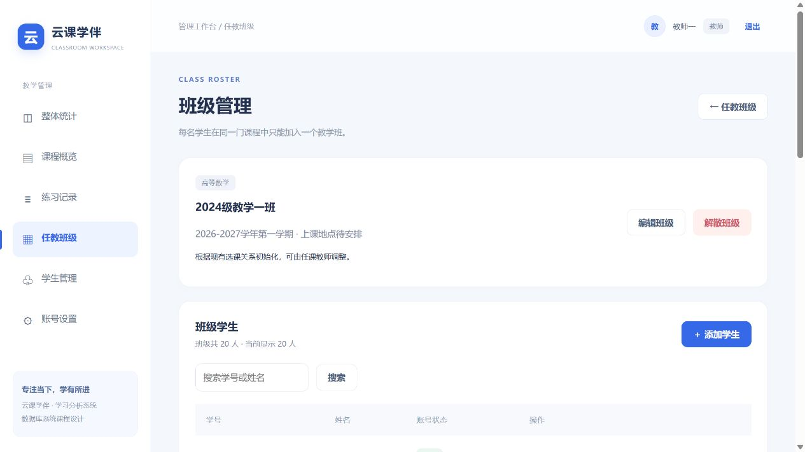

# Cloud Classroom · 云课学伴

基于 Spring Boot、MyBatis 和 MySQL 的课堂教学与学习分析系统，采用原生 HTML/CSS/JavaScript 和 Nginx 展示蓝白色教学工作台。

当前已实现课程练习、自动评分、错题与薄弱项分析、教师课程分工、学生自主选退课和教学班管理。新增教师与学生个人周课表，每门课每周两次，周末不排课；课表按教师负责课程和学生选课实时过滤。支持教师在课程内发布普通签到、四位数字口令签到，学生接收提醒并完成签到，教师查看签到名单和人数。

## 功能

| 角色 | 功能 |
| --- | --- |
| 学生 | 查看与搜索已开课程、加入/退出课程、固定章节练习、自主随机练习、自动评分、结果解析、练习历史、错题重练、知识点分析、趋势、修改密码 |
| 教师 | 负责课程的统计分析、练习记录与结果、学生学习详情、学生账号创建/启停/重置密码、教学班创建/编辑/解散和成员管理 |

教师只能访问自己负责课程的数据。学生必须先加入课程才能练习；退课保留学习记录，并同步移出该课程的教学班，重新加入后恢复学习记录。移出班级不会退课。同一学生在同一门课程中最多加入一个教学班。

示例数据包含 5 门课程、25 个当前章节、500 道题、20 名学生、500 次已提交练习、10000 条作答，以及 5 个默认教学班、100 条班级成员关系。

## 界面预览




## 技术栈

- Java 编译目标 17，Spring Boot 4.0.5，MyBatis Starter 4.0.1，Maven。
- MySQL 8.4+，外键、唯一键、CHECK 约束与事务维护数据一致性。
- 原生 HTML/CSS/JavaScript，无前端构建依赖；Nginx 提供页面与 API 反向代理。
- BCrypt 密码哈希、JWT 登录、教师课程权限和学生选课权限校验。

本地已使用 Windows、Java 25、Maven 3.9.12、MySQL 9.6 和 Nginx 1.22 运行。启动脚本面向 Windows PowerShell。

## 获取与运行

```powershell
git clone https://github.com/ybbsb233/cloud-classroom.git
cd cloud-classroom
mvn -B -f backend/pom.xml package
```

安装 Java 17+、Maven、MySQL 8.4+ 和 Nginx，并确保 java、mvn、mysql 可以在命令行调用。

### 1. 初始化数据库（新环境）

推荐导入完整演示数据：

```powershell
.\scripts\init-database.ps1 -WithHistory
```

脚本提示输入 MySQL 密码，创建独立的 `classroom_learning` 数据库。发现数据库已存在时会停止，不覆盖已有数据。

仅创建基础题库和教师账号，不导入演示学生与练习记录：

```powershell
.\scripts\init-database.ps1
```

两种方式二选一。两者均执行 `sql/init.sql`，直接创建当前完整的 14 张表，并导入两名教师、课程、题库、默认教学班和周课表，不再串联旧升级脚本。`-WithHistory` 额外执行纯数据脚本 `sql/demo_history.sql`，导入演示学生、选课、班级成员和练习历史。

也可以在 MySQL 命令行直接执行 `SOURCE /项目绝对路径/sql/init.sql;`；需要演示历史时再执行 `SOURCE /项目绝对路径/sql/demo_history.sql;`。`init.sql` 仅用于新库：数据库已存在时立即报错，不含 `DROP`、`ALTER` 或关闭外键检查的语句。请勿对现有数据库重复初始化。

旧版 00 至 10 SQL 已归档到 `sql/legacy/`，仅供追溯和旧库升级；不要按文件编号将历史脚本与 `init.sql` 混合执行。

如 mysql 未加入 PATH，可指定 `-MySqlPath 'D:\mysql\bin\mysql.exe'`，并用 `-DbHost`、`-DbPort`、`-DbUser` 调整连接参数。

### 2. 启动网站

```powershell
.\scripts\start-site.ps1 -NginxPath 'D:\nginx-1.22.0-web\nginx.exe'
```

按提示输入 MySQL 密码。已有教师账号时，初始教师密码提示可填任意非空占位值，启动不会覆盖账号密码。数据库密码和随机 JWT 密钥不写入源码。重启更换 JWT 密钥后需重新登录。

访问 **http://127.0.0.1:18091/login.html**，后端监听 `127.0.0.1:18090`。

```powershell
# 修改端口
.\scripts\start-site.ps1 -Port 19091 -BackendPort 19090 -NginxPath 'D:\nginx\nginx.exe'
# 停止本项目，不停止 MySQL 或其他项目
.\scripts\stop-site.ps1 -NginxPath 'D:\nginx-1.22.0-web\nginx.exe'
```

运行日志和 PID 位于系统 TEMP 下的 `classroom-learning-nginx`。Java 构建产物为 `backend/target/classroom-learning-1.0.0.jar`。修改后端后先停止本项目，再构建并重新启动，避免 Windows 的 JAR 文件占用。

### 每周课表

教师与学生均可从侧栏“我的课表”进入。五门课程共 10 次课，分散在不同工作日的四个时段（08:20–10:00、10:20–12:00、14:00–15:40、16:00–17:40），所有课程时间不重叠。支持上周/下周、本周、日期选择及课程详情弹窗；周末留空。当前是每周重复课表，未配置学期起止、节假日或调课。

已有数据库增加课表表和默认排课（可重复执行，不覆盖已有排课）：

```powershell
.\scripts\upgrade-schedule.ps1
```

新环境的 `sql/init.sql` 已包含课表结构和默认排课。数据库唯一约束禁止全局时段重叠，CHECK 约束禁止周末排课。

### 课程签到

教师：课程概览 → 课程详情 → 课程签到，可选择普通/口令签到、有效时长并发布。四位数字由服务器生成并仅向教师返回；支持前导零。学生：从侧栏“课程签到”进入，首页显示待签到提醒，普通签到点击即可，口令签到输入教师展示的数字。通知及人数每 10 秒检查更新。

发布时保存已选课且启用的学生名单；后加入课程的学生不追加入已发布签到。学生退课后不再看到或提交该课程签到。每人每次只记录一次签到时间，截止或教师提前结束后无法继续签到。教师可查看应签/已签人数、学生名单及时间。

已有环境执行 `.\scripts\upgrade-attendance.ps1`；新环境的 `sql/init.sql` 已包含签到表。`python scripts/verify_attendance.py` 验证普通/口令签到、重复提交、到期、结束、名单与权限，并恢复测试学生选课与班级；设置 `MYSQL_PWD` 时会清理本次自动验证产生的签到，否则保留为已结束记录。

### 演示账号

| 账号 | 密码 | 负责课程 |
| --- | --- | --- |
| teacher01 | 123456 | 高等数学、数据库系统原理 |
| teacher02 | 123456 | 单片机、数据结构、计算机网络 |
| 20240001 至 20240020 | 123456 | 全部五门课，完整演示初始化时提供 |

以上均为课程设计演示账号，不是数据库凭据。原 admin 已通过迁移改为 teacher01。两位教师均具有学生账号管理能力。

## 数据库升级

当前电脑已升级，无需再次初始化。其他已有旧版数据库按版本依次执行：

```powershell
.\scripts\upgrade-teachers.ps1
.\scripts\upgrade-classes.ps1
```

教师和教学班升级脚本先备份，并在已升级时跳过，不重新选课或覆盖班级名单。它们读取 `sql/legacy/` 中的 07、08 一次性迁移文件；新安装无需运行任何升级脚本。课表与签到升级入口保留给尚未增加相应表的旧库。

## 验证

```powershell
mvn -B -f backend/pom.xml test
python scripts/verify_frontend.py
python scripts/verify_schedule.py
python scripts/verify_migration.py
python scripts/verify_enrollment.py
python scripts/verify_classes.py
python scripts/verify_init.py
# 通过 MYSQL_PWD 环境变量提供数据库密码后运行
python scripts/verify_schema.py
```

- `verify_migration.py`：只读学习记录，默认使用教师一和前两名演示学生；改密后通过 TEST_ADMIN_PASSWORD、TEST_STUDENT_PASSWORD 指定。
- `verify_enrollment.py`：临时调整 20240020 的选课，结束后恢复课程与班级关系；教师密码通过 TEST_TEACHER_PASSWORD 指定。
- `verify_classes.py`：临时移动 20240020 并创建测试班，结束后恢复原班名单，测试班解散归档。上述两项用于演示环境，并要求该学生最初已加入五门课及默认教学班。
- HTTP 脚本默认网站端口为 18091，可通过 TEST_BASE_URL 或 TEST_WEB_URL 覆盖。
- `verify_init.py`：连接 MySQL 后在随机命名的临时测试库中检查统一初始化、可选历史、重复导入保护及关键约束，结束后删除本次测试库；不修改 `classroom_learning`。数据库脚本通过 `MYSQL_PWD` 认证，可用 `DB_HOST`、`DB_PORT`、`DB_USERNAME` 和 `MYSQL_PATH` 指定连接。

验证覆盖评分规则、真实数据库完整性、资源与模块依赖、权限隔离、选退课、分班、批量操作回滚等。详细结果及浏览器验证范围见 docs/verification 和设计文档。

## 目录

课程设计报告位于 `实验报告/课程设计报告.docx`，功能模块图和 E-R 图的 PNG 图片、可编辑 draw.io 文件位于 `实验报告/图表/`。任务书和报告样例位于 `docs/reference/课程设计资料/`。

```text
backend/        Spring Boot 后端、MyBatis Mapper、单元测试
frontend/       21 个页面、共享样式和 JavaScript 模块
deploy/         Nginx 配置模板
sql/            init.sql 当前统一建表与基础数据、demo_history.sql 可选历史
sql/legacy/     旧版 SQL 与一次性升级脚本，不参与新库初始化
scripts/        启动、停止、初始化、升级和验证脚本
docs/design/    当前教师、选课与教学班设计
docs/reference/ 原版业务设计参考，历史标识不代表当前实现
docs/verification/ 验证记录与页面截图
```

本地备份、日志、编译产物、私有配置和依赖历史备份的开发辅助脚本不纳入仓库。未附加开源许可证。
